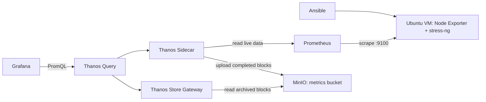

# Observability Lab

Локальный стенд мониторинга Ubuntu: Ansible, Node Exporter, Prometheus, Grafana,
Thanos и S3-совместимое хранилище MinIO. Позволяет создавать ограниченную по времени
нагрузку на CPU, память и диск, наблюдать метрики и проверять алерты.

## Архитектура



VM работает через Multipass, остальные компоненты — в Docker Compose на Mac.
Grafana получает как свежие, так и архивные данные через один источник Thanos Query.
Sidecar использует общий том с Prometheus. Store Gateway хранит локальный кеш,
а архив блоков находится в MinIO.

## Что можно продемонстрировать

- Идемпотентная подготовка Ubuntu через Ansible: Node Exporter, stress-ng, сервис systemd.
- Сбор метрик каждые 10 секунд, PromQL и четыре панели Grafana.
- CPU-алерт выше 70% в течение 20 секунд и алерт недоступности Node Exporter.
- Загрузка блоков Sidecar в MinIO и запрос архива через Store Gateway.
- Настройки и дашборд в Git; локальные пароли и адрес ВМ исключены из Git.

## Требования

Проверено на macOS ARM64 с Docker Desktop и Ubuntu 24.04 в Multipass.
Нужны Docker Compose v2+, Multipass, Python 3.14 и SSH-ключ.
На ВМ выделено 2 CPU, 1 GiB RAM и 8 GiB диска. Лимиты постоянно работающих
контейнеров суммарно около 2.5 GiB; сборка MinIO требует дополнительной памяти,
свободного места и интернета. Первая сборка может занять несколько минут.

Образ MinIO собирается из официального исходного кода: release tag и ожидаемый
Git commit проверяются в Dockerfile. Остальные образы закреплены по версиям.
Зависимости Go скачиваются во время сборки; это не автономная сборка без сети.

## Первый запуск

Все команды ниже выполняются из корня репозитория.

### 1. Ubuntu VM и SSH

Если ВМ ещё нет:

```bash
multipass launch 24.04 --name monitor-lab --cpus 2 --memory 1G --disk 8G
```

Создай ключ, если он ещё не существует:

```bash
ssh-keygen -t ed25519 -f ~/.ssh/ansible_lab
```

Добавь публичный ключ на ВМ без дублирования:

```bash
cat ~/.ssh/ansible_lab.pub | multipass exec monitor-lab -- bash -c '
  set -eu
  key=$(cat)
  mkdir -p ~/.ssh
  chmod 700 ~/.ssh
  touch ~/.ssh/authorized_keys
  grep -qxF "$key" ~/.ssh/authorized_keys || printf "%s\n" "$key" >> ~/.ssh/authorized_keys
  chmod 600 ~/.ssh/authorized_keys
'
multipass info monitor-lab
```

Скопируй IPv4 ВМ. Далее `192.0.2.10` — пример, его нужно заменить своим адресом.

### 2. Локальные настройки и Ansible

```bash
python3 -m venv .venv
.venv/bin/python -m pip install -r requirements.txt
python3 scripts/configure.py 192.0.2.10
cp ansible/inventory.ini.example ansible/inventory.ini
```

В `ansible/inventory.ini` замени `ansible_host=192.0.2.10` на тот же IP.
При необходимости измени путь SSH-ключа и пользователя.

`configure.py` создаёт `.env` со случайными паролями только при отсутствии файла;
существующие пароли сохраняются. Адрес цели записывается в `prometheus/targets.json`.
Оба файла локальные и игнорируются Git. `.env.example` показывает нужные переменные.

```bash
.venv/bin/ansible-playbook -i ansible/inventory.ini ansible/playbook.yml
.venv/bin/ansible-playbook -i ansible/inventory.ini ansible/playbook.yml
```

Повторный запуск должен завершиться без ошибок и с `changed=0`, если состояние ВМ
не менялось. При первом SSH-подключении проверь и подтверди ключ хоста.

### 3. Запуск мониторинга

```bash
bash scripts/up.sh
```

Скрипт проверяет конфигурацию, запускает MinIO и Prometheus, ждёт готовности MinIO,
создаёт bucket `metrics` при необходимости и запускает остальной стек.
Одноразовый сервис `store-init` назначает UID 1001 владельцем каталога Store;
Sidecar работает с UID 65534, как Prometheus. Ручной `chown` больше не требуется.
Успешное состояние `store-init` — `Exited (0)`; это ожидаемо.

| Компонент | Адрес с Mac |
|---|---|
| Grafana | http://127.0.0.1:3000/d/linux-lab |
| Prometheus | http://127.0.0.1:9090 |
| Thanos Query | http://127.0.0.1:10904 |
| MinIO S3 API | http://127.0.0.1:9000 |
| MinIO console | http://127.0.0.1:9001 |

Grafana: пользователь `admin`, пароль — `GRAFANA_ADMIN_PASSWORD` из `.env`.
Не публикуй `.env` или полный вывод `docker compose config`: он содержит подставленные
пароли. Для проверки синтаксиса используй `docker compose config --quiet`.
Порты контейнеров доступны только через loopback Mac; порт экспортера находится на ВМ.

## Дашборд и PromQL

В Grafana выбери **Last 15 minutes**, обновление **5s**. После запуска подожди
несколько сборов метрик; CPU вычисляется по окну в одну минуту.

| Панель | Смысл |
|---|---|
| CPU | Доля времени CPU вне idle, усреднённая по ядрам |
| RAM | Доля памяти, недоступной как MemAvailable |
| Root filesystem | Доля файловой системы `/`, недоступной обычному пользователю, включая резерв |
| Node Exporter | Результат последнего scrape: UP / DOWN |

Пример CPU-запроса:

```promql
100 * (1 - avg by (instance) (
  rate(node_cpu_seconds_total{job="node",mode="idle"}[1m])
))
```

Остальные выражения сохранены в `grafana/dashboards/linux.json`.
Дашборд и datasource provisioned из файлов; постоянные изменения вноси туда.

## Демонстрация нагрузки

Выполняй эксперименты по одному:

```bash
bash scripts/load.sh cpu
bash scripts/load.sh memory
bash scripts/load.sh disk
```

CPU: два worker на 90 секунд. RAM: один worker с 256 MiB на 60 секунд.
Диск: реальный файл 256 MiB в `/var/tmp/monitor-load`, удерживается 60 секунд,
затем удаляется через trap. Скрипт не перезаписывает уже существующий demo-файл.
При аварийном выключении ВМ файл может остаться; удали именно
`/var/tmp/monitor-load/demo.bin` перед повторением.
Если имя ВМ другое: `MONITOR_VM=my-vm bash scripts/load.sh cpu`.

## Алерты

Открой http://127.0.0.1:9090/alerts во время CPU-нагрузки: `HighCPUUsage`
должен пройти `Pending → Firing`, затем вернуться в неактивное состояние.
Из-за окна rate и периода вычисления переход происходит с задержкой.

Для проверки `NodeExporterDown`:

```bash
multipass exec monitor-lab -- sudo systemctl stop prometheus-node-exporter
# Подожди примерно 30–40 секунд и проверь Alerts.
multipass exec monitor-lab -- sudo systemctl start prometheus-node-exporter
```

Алерты вычисляет Prometheus. Alertmanager и отправка уведомлений в этот стенд не входят.

## Проверка архива Thanos

```bash
python3 scripts/check-archive.py
```

Скрипт временно переключает Query на **единственный источник Store Gateway**,
запрашивает `up{job="node"}` за последние сутки и требует непустого результата.
В `finally` восстанавливает обычную конфигурацию с Sidecar и Store.
Так проверяется чтение через архивный путь, без использования Sidecar.
При ручной проверке этого стенда получено 179 архивных точек.

Новые метрики попадают в MinIO только после закрытия блока и загрузки Sidecar.
В лаборатории блок — 2 минуты; после чистого запуска обычно нужно подождать
несколько минут, плюс синхронизацию Store. Предупреждение Sidecar о рекомендуемом
блоке 2h ожидаемо. Если история старше суток, скрипт её не найдёт.

Если проверку прервали принудительно и восстановление не выполнилось:

```bash
docker compose up -d --no-deps thanos-query
```

## Остановка и продолжение

```bash
docker compose stop
multipass stop monitor-lab
```

Продолжить:

```bash
multipass start monitor-lab
multipass info monitor-lab
# Если IP поменялся: повтори configure.py с новым IP и обнови inventory.ini.
bash scripts/up.sh
```

Данные сохраняются в named volumes. `docker compose down` удаляет контейнеры,
но сохраняет эти тома. **`docker compose down -v` удаляет метрики, архив и данные Grafana.**
Пока Mac спит, выключен или ВМ остановлена, новые метрики не собираются.
После пересоздания контейнеров Grafana файлы provisioning применяются снова.

## Диагностика

```bash
docker compose config --quiet
docker compose ps -a
docker compose logs --tail=50 prometheus thanos-sidecar thanos-store thanos-query
curl --fail --max-time 5 http://VM_IP:9100/metrics -o /dev/null
```

- **No route to host в VS Code, но работает в Terminal:** проверь разрешение
  macOS «Конфиденциальность и безопасность → Локальная сеть» для VS Code.
  В этом стенде нагрузка успешно запускалась из обычного Terminal.
- **UP=0:** проверь ВМ, IP в `prometheus/targets.json`, сервис Node Exporter и
  страницу Prometheus `/targets`. Доступ с Mac не гарантирует доступ из Docker;
  последнюю проверку подтверждает именно статус target.
- **Query не показывает свежих данных:** проверь endpoints на странице Thanos
  `/stores`, логи Sidecar и URL Grafana `http://thanos-query:10902`.
- **Store permission denied:** проверь, что используется текущий Compose с
  `store-init`, затем выполни `docker compose up -d`.
- **Grafana не принимает новый пароль из .env:** пароль применяется при создании
  базы Grafana. Изменение переменной не меняет пароль существующего пользователя.

## Границы стенда

Одна ВМ и один экземпляр каждого сервиса: здесь нет HA и multi-DC.
Prometheus хранит локальную историю до 6 часов с ограничением 256 MB
(удаление выполняется целыми блоками, лимит не ограничивает весь размер тома).
MinIO локальный, его том не является внешним резервным копированием.
Compactor и автоматическое удаление архива не настроены: архив постепенно растёт.
Двухминутные блоки выбраны для быстрой демонстрации, для длительной эксплуатации
нужны другое планирование хранения и проверка ресурсов.

## Структура

```text
ansible/                 Подготовка Ubuntu и пример inventory
prometheus/              Сбор метрик, правила алертов, пример цели
grafana/                 Provisioning и дашборд
scripts/                 Настройка, запуск, нагрузка и проверка архива
docker/minio/            Сборка MinIO из закреплённого исходного кода
compose.yaml             Основной стек
compose.archive-check.yaml  Режим запроса только архива
```
